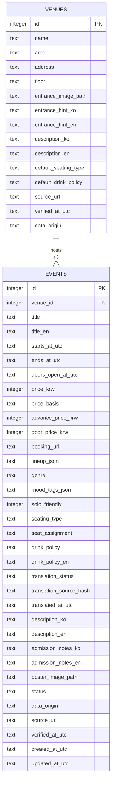

# AMP — SQLite 데이터베이스 명세 (DATABASE.md)

> 버전 **v1.1** · 2026-11-06 · 개발 전 확정 제안 · 범위: 신촌·홍대 공연 MVP  
> **구현 기준 문서**: 필드명·테이블·가격 정책의 원본 계약. API 표현은 [API.md](./API.md)를 따른다.

## 1. 설계 원칙

1. `venues 1:N events` 관계를 유지한다. **MVP에서는 `events.venue_id`가 필수**이며, DB에 없는 공연장을 AI가 자동 생성하지 않는다.
2. 장소의 물리적 정보(주소, 층수, 입구)는 `venues`; 공연마다 바뀌는 입장 시각·가격·좌석·공지 사항은 `events`에 저장한다.
3. 공연별 `seating_type`·`drink_policy`가 있으면 그 값이 장소 기본값보다 우선한다. **장소 기본값은 해당 공연의 확정 정책이라는 뜻이 아니다.**
4. `0`원은 검증된 무료, `NULL`은 미확인이다. 미확인 값을 무료로 표현하지 않는다.
5. 행사마다 다른 예매가·현장가를 구분한다. 기존 `price_krw`는 **검색용 대표 가격**으로 유지한다.
6. `verified`(출처·확인 과정 있는 실제 정보)와 `demo`(가상 시연 데이터)를 구분하고, `demo`는 UI에 표시한다.
7. DB 시각은 **UTC ISO 8601 문자열(`YYYY-MM-DDTHH:MM:SSZ`)**로 저장한다. 상대 날짜와 표시는 `Asia/Seoul`을 기준으로 한다.
8. 공연 원문은 등록자가 확인하고, 영문은 등록 시 자동 생성해 번역 상태와 함께 저장한다. 원문에 없는 입구·좌석·안전·관람 규칙을 추가하지 않는다. 장소의 기존 영문은 사전 검수본을 유지한다.

## 2. ERD



## 3. `venues` 스키마 — 기존 구조 유지

| 필드 | 타입 / 제약 | 의미 |
|---|---|---|
| `id` | INTEGER PK | 장소 ID |
| `name` | TEXT NOT NULL | 공연장명 |
| `area` | TEXT CHECK | `sinchon` / `hongdae` |
| `address` | TEXT NULL | 검증된 주소 |
| `floor` | TEXT NULL | `B1`, `2F` 등 |
| `entrance_image_path` | TEXT NULL | 허가받은 입구 사진 경로 |
| `entrance_hint_ko`, `entrance_hint_en` | TEXT NULL | 장소 입구/이동 안내 (검수된 언어별 텍스트) |
| `description_ko`, `description_en` | TEXT NULL | 장소 소개 |
| `default_seating_type` | TEXT NULL | 장소의 일반적인 형태: `standing`, `seated`, `mixed` |
| `default_drink_policy` | TEXT NULL | 확인된 기본 정책; 공연별 변동 가능 |
| `source_url` | TEXT NULL | 출처 링크 |
| `verified_at_utc` | TEXT NULL | 확인 시점(UTC) |
| `data_origin` | TEXT NOT NULL | `verified` / `demo` |

`default_guide_en`이라는 별도 필드는 추가하지 않는다. 기존 `entrance_hint_en`을 재사용한다.

## 4. `events` 스키마

| 필드 | 타입 / 제약 | 의미 |
|---|---|---|
| `id` | INTEGER PK | 이벤트 ID |
| `venue_id` | INTEGER NOT NULL FK | 반드시 기존 공연장 선택 |
| `title` | TEXT NOT NULL | 원문 공연명 1~120자 |
| `title_en` | TEXT NULL | 등록 시 자동 생성하는 영문 제목, 최대 500자 |
| `starts_at_utc`, `ends_at_utc` | TEXT / 종료 NULL | 공연 시작·종료 UTC |
| `doors_open_at_utc` | TEXT NULL **v1.1 추가** | 입장 시작 시각 UTC |
| `price_krw` | INTEGER NULL, >=0 | 검색용 대표 가격. 아래 규칙으로 산출 |
| `price_basis` | TEXT NULL **v1.1 추가** | 대표 가격 출처: `advance`, `door`, `general` |
| `advance_price_krw` | INTEGER NULL, >=0 **추가** | 예매가 |
| `door_price_krw` | INTEGER NULL, >=0 **추가** | 현장가 |
| `booking_url` | TEXT NULL **추가** | 확인된 티켓 예매 링크 |
| `lineup_json` | TEXT NOT NULL | JSON 문자열 배열 |
| `genre` | TEXT NULL | 검수된 장르 |
| `mood_tags_json` | TEXT NOT NULL | 허용 태그 배열(JSON) |
| `solo_friendly` | INTEGER NULL/0/1 | 근거가 있을 때만 혼자 방문 적합성 표시 |
| `seating_type` | TEXT NULL | `standing`, `seated`, `mixed` |
| `seat_assignment` | TEXT NULL **추가** | `assigned`(지정석), `unassigned`(비지정석) |
| `drink_policy` | TEXT NULL | 해당 공연 드링크 규정 한국어 원문, 최대 4,000자 |
| `drink_policy_en` | TEXT NULL | 자동 번역, 최대 12,000자 |
| `description_ko`, `description_en` | TEXT NULL | 공연 소개 |
| `admission_notes_ko`, `admission_notes_en` | TEXT NULL **추가** | 한국어 입장 안내와 등록 시 자동 생성하는 영어 번역 |
| `translation_status` | TEXT NOT NULL | `not_requested`(기본), `generated`, `failed`, `reviewed` |
| `translation_source_hash` | TEXT NULL | 번역에 사용한 정규화 원문 지문(SHA-256), API에 노출하지 않음 |
| `translated_at_utc` | TEXT NULL | 성공한 번역 생성 시각 UTC |
| `poster_image_path` | TEXT NULL | 사용 권리가 있는 포스터 경로 |
| `status` | TEXT NOT NULL | `draft`, `published`, `cancelled` |
| `data_origin` | TEXT NOT NULL | `verified` / `demo` |
| `source_url`, `verified_at_utc` | TEXT NULL | 출처와 확인 시점 |
| `created_at_utc`, `updated_at_utc` | TEXT NOT NULL | DB 작성/변경 시각 |

**좌석 관련 용어 구분:** `seating_type=seated`는 앉아서 보는 방식, `seat_assignment=unassigned`는 비지정석이다. ‘선착순 입장’은 좌석 배정과 다른 규칙이므로 `admission_notes_*`에 기재한다. `mixed`는 좌석이 보장된다는 의미가 아니다.

## 5. 가격 데이터 계약 (중요)

`price_krw`는 **현재 서버에서 확인 가능한 가장 낮은 명시 가격**을 대표한다. 이는 티켓 실시간 재고/구매 가능을 보장하지 않는다.

| 입력 상태 | `price_krw` | `price_basis` | 화면 예시 |
|---|---:|---|---|
| 예매 20,000 / 현장 25,000 | 20000 | `advance` | 예매 시 20,000원 · 현장 25,000원 |
| 예매 NULL / 현장 25,000 | 25000 | `door` | 현장 25,000원 |
| 단일 가격 15,000 (구분 없음) | 15000 | `general` | 안내 가격 15,000원 |
| 확인된 무료 공연 | 0 | `general` | 무료 |
| 모두 미확인 | NULL | NULL | 가격 확인 필요 |

**저장 규칙:** (1) 예매가나 현장가가 하나라도 있으면 서버가 `price_krw=min(non-null 가격)`과 `price_basis`를 결정하며, 동가이면 `advance`를 우선한다. (2) 둘 다 없으면 검수한 단일 `price_krw`를 받아 `general`로 저장한다. (3) 가격 출처가 없으면 둘 다 NULL. (4) 클라이언트가 구분 가격과 서로 다른 대표 가격을 동시에 보내면 422로 거절한다. (5) 금액은 음수를 허용하지 않는다.

예매가를 검색 기준으로 사용해도 **현재 예매가 가능한지 확인하지 않았으면 구매 가능하다고 단정하지 않는다.** 카드에 가격 출처를 반드시 표시한다. `max_price_krw=0`은 확인된 무료만 허용한다.

## 6. 최소 SQLite DDL — 실행 기준

```sql
PRAGMA foreign_keys = ON;

CREATE TABLE IF NOT EXISTS venues (
    id INTEGER PRIMARY KEY AUTOINCREMENT,
    name TEXT NOT NULL,
    area TEXT NOT NULL CHECK (area IN ('sinchon','hongdae')),
    address TEXT,
    floor TEXT,
    entrance_image_path TEXT,
    entrance_hint_ko TEXT,
    entrance_hint_en TEXT,
    description_ko TEXT,
    description_en TEXT,
    default_seating_type TEXT CHECK (default_seating_type IS NULL OR default_seating_type IN ('standing','seated','mixed')),
    default_drink_policy TEXT,
    source_url TEXT,
    verified_at_utc TEXT,
    data_origin TEXT NOT NULL CHECK (data_origin IN ('verified','demo'))
);

CREATE TABLE IF NOT EXISTS events (
    id INTEGER PRIMARY KEY AUTOINCREMENT,
    venue_id INTEGER NOT NULL REFERENCES venues(id),
    title TEXT NOT NULL,
    title_en TEXT,
    starts_at_utc TEXT NOT NULL,
    ends_at_utc TEXT,
    doors_open_at_utc TEXT,
    price_krw INTEGER CHECK (price_krw IS NULL OR price_krw >= 0),
    price_basis TEXT CHECK (price_basis IS NULL OR price_basis IN ('advance','door','general')),
    advance_price_krw INTEGER CHECK (advance_price_krw IS NULL OR advance_price_krw >= 0),
    door_price_krw INTEGER CHECK (door_price_krw IS NULL OR door_price_krw >= 0),
    booking_url TEXT,
    lineup_json TEXT NOT NULL DEFAULT '[]' CHECK (json_valid(lineup_json)),
    genre TEXT,
    mood_tags_json TEXT NOT NULL DEFAULT '[]' CHECK (json_valid(mood_tags_json)),
    solo_friendly INTEGER CHECK (solo_friendly IS NULL OR solo_friendly IN (0,1)),
    seating_type TEXT CHECK (seating_type IS NULL OR seating_type IN ('standing','seated','mixed')),
    seat_assignment TEXT CHECK (seat_assignment IS NULL OR seat_assignment IN ('assigned','unassigned')),
    drink_policy TEXT,
    drink_policy_en TEXT,
    translation_status TEXT NOT NULL DEFAULT 'not_requested' CHECK (translation_status IN ('not_requested','generated','failed','reviewed')),
    translation_source_hash TEXT,
    translated_at_utc TEXT,
    description_ko TEXT,
    description_en TEXT,
    admission_notes_ko TEXT,
    admission_notes_en TEXT,
    poster_image_path TEXT,
    status TEXT NOT NULL DEFAULT 'published' CHECK (status IN ('draft','published','cancelled')),
    data_origin TEXT NOT NULL CHECK (data_origin IN ('verified','demo')),
    source_url TEXT,
    verified_at_utc TEXT,
    created_at_utc TEXT NOT NULL,
    updated_at_utc TEXT NOT NULL,
    CHECK ((price_krw IS NULL AND price_basis IS NULL) OR (price_krw IS NOT NULL AND price_basis IS NOT NULL))
);

CREATE INDEX IF NOT EXISTS idx_events_status_start ON events(status, starts_at_utc);
CREATE INDEX IF NOT EXISTS idx_events_venue ON events(venue_id);
CREATE INDEX IF NOT EXISTS idx_events_price ON events(price_krw);
CREATE INDEX IF NOT EXISTS idx_events_seating ON events(seating_type);
CREATE INDEX IF NOT EXISTS idx_venues_area ON venues(area);
```

DDL의 가격 산출 동기화·날짜 비교·URL 유효성 검사는 **백엔드 Pydantic/서비스 계층**이 담당한다. 앱 연결마다 `PRAGMA foreign_keys=ON`을 적용한다. SQLite의 JSON1 `json_valid()` 지원 여부를 개발 환경에서 확인한다.

## 7. 필터링·우선순위

### 날짜
- `starts_at_local=2026-11-07T19:00:00`(KST)을 `starts_at_utc=2026-11-07T10:00:00Z`로 변환해 저장한다.
- `today`는 실행일의 KST 날짜로 해석한다. KST 자정 범위를 UTC로 변환해 비교한다.
- `upcoming=true`는 `starts_at_utc >= now_utc`를 적용한다. 지난 공연·`cancelled`·`draft`는 공개 추천에 포함하지 않는다.
- 검수 시 `doors_open_at_utc <= starts_at_utc`, `ends_at_utc > starts_at_utc`를 확인한다(각 값이 있는 경우).

### AI 조회 도구의 필수 조건 실행(개념 SQL)

```sql
SELECT e.*
FROM events e
JOIN venues v ON e.venue_id = v.id
WHERE e.status = 'published'
  AND e.starts_at_utc >= :now_utc
  AND (:min_utc IS NULL OR e.starts_at_utc >= :min_utc)
  AND (:max_utc IS NULL OR e.starts_at_utc < :max_utc)
  AND (:area IS NULL OR v.area = :area)
  AND (:max_price IS NULL OR (e.price_krw IS NOT NULL AND e.price_krw <= :max_price))
  AND (:seating_requirement IS NULL OR e.seating_type = :seating_requirement);
```

**엄격한 좌석 조건**에는 `events.seating_type`이 명확히 기록된 경우만 일치시킨다. 장소의 `default_seating_type`만으로 '좌석 확정'이라고 판단하지 않는다.

위 SQL은 필수 조건 실행 예시다. 실제 조회는 [AI.md](./AI.md)의 `EventQuery` 허용 필드·타입·연산을 검증해 파라미터 바인딩으로 조립한다. AI가 날짜 범위·가격·지역 외에도 제목·출연진·설명·장르 등으로 검색하고 결과를 보고 재조회할 수 있다. 검색 방식 변경 자체에는 추가 테이블이 필요하지 않으며, 등록 번역용 컬럼은 위 DDL에 포함한다.

### AI 조회와 추천의 책임

- 서버가 공개·미래 공연, UI 필수 필터, 최초 조회에서 확정한 필수 조건을 모든 재조회에 강제한다.
- 조회 도구는 읽기 전용으로 실행하며 `starts_at_utc ASC, id ASC` 순서와 서버 발급 커서로 페이지를 반환한다. 검색 범위를 바꾸면 커서를 초기화한다.
- AI는 원문과 조회된 설명·태그·좌석 등으로 비교하고 추천 순서를 결정한다. Python 고정 가중치 점수는 사용하지 않는다.
- 추천 직전에 ID·공개 상태·필수 조건·근거 데이터를 재검사한다. 모델이 만든 가격/좌석 값을 DB 사실 대신 반환하지 않는다.
- `total_matches`는 확정된 필수 조건 전체 일치 건수이고, 탐색 키워드 결과 건수나 AI가 선택한 개수와 구분한다.

## 8. 장소/입장 가이드 표시 정책

- `events.seating_type`, `events.drink_policy`가 있으면 행사 값을 사용한다.
- 해당 공연 값이 없으면 `venues.default_*`를 **'공연장 기본 정보(공연별 확인 필요)'** 라벨과 함께 표시한다. 둘 다 없으면 `확인 필요`.
- `events.doors_open_at_utc`가 없으면 입장 시간 미확인으로 표시한다. 공연 시작 시각을 입장 시각으로 복제하지 않는다.
- `events.seat_assignment`와 '선착순 입장'(`admission_notes_*`)을 따로 표시한다.
- 장소 입구 방향은 `entrance_hint_*`; 해당 공연 특이사항은 `admission_notes_*`에 표시한다. 상호 대체하지 않는다.
- 공연 영문은 원문 지문이 일치하는 `generated|reviewed` 상태만 표시한다. `generated`에는 `AI-translated`와 원문 보기 제공; `reviewed`는 실제 영어 검수가 확인된 시드/관리 데이터에만 사용한다.
- 영문이 없거나 번역 실패/원문 변경 상태이면 해당 한국어 원문과 `영문 번역 준비 안 됨`을 표시한다. 필드 자체가 원문에도 없으면 정보 미확인으로 표시한다. 장소의 기존 영문 표시 정책은 유지한다.
- 정보의 출처/검증일이 없거나 `data_origin=demo`이면 각각 미확인/DEMO로 표시한다.

### 등록 번역의 저장 계약

- `description_ko`/`admission_notes_ko`는 최대 4,000자, 대응 영문은 최대 12,000자. 길이·공백 정규화·번역 무결성은 서비스 계층에서 검증한다.
- 번역 대상은 `title`, `description_ko`, `admission_notes_ko`, `drink_policy`다. 등록 요청에는 영문/번역 상태를 받지 않는다.
- `generated|reviewed`: 원문 지문과 생성 시각 필수, 원문이 있는 필드의 번역 필수. `failed`: 시도한 원문 지문은 기록하고 영문 전체와 생성 시각은 NULL. `not_requested`: 영문·지문·생성 시각 모두 NULL.
- 최초 등록은 원문과 번역 결과를 함께 저장한다. 번역만 실패하면 `failed`로 정상 등록한다. DB 저장 실패를 성공 응답으로 바꾸지 않는다.
- 번역 재시도는 원문 지문을 저장 직전에 비교하고 같은 원문일 때만 갱신한다. 같은 지문의 정상 번역은 재사용하고, 동시 성공을 늦은 실패가 덮어쓰지 않는다.
- 원문 수정 시 기존 번역 묶음을 비우고 `not_requested`로 전환한다. 성공 번역 시 네 영문 필드·지문·생성 시각·상태를 원자적으로 갱신한다.
- 시드의 검수 영문은 `reviewed`와 지문·생성 시각을 명시한다. `data_origin=verified`나 원문 검수 여부만으로 영어까지 `reviewed`라고 표시하지 않는다.
- 현재는 개발 전 DDL 변경이다. 기존 DB에 적용할 때 `CREATE TABLE IF NOT EXISTS`는 컬럼을 추가하지 않으므로 별도 마이그레이션이 필요하다.

## 9. 공연장 매칭 정책 (앱 로직)

- Vision LLM은 `venue_name` 문자열만 추출하며 **`venue_id`를 판단하거나 신규 공연장을 생성하지 않는다.**
- 서버는 정규화(유니코드 NFKC, 공백, 영문 대소문자, 간단한 구두점)한 장소명으로 **기존 `venues.name`과 비교**한다.
- 유일한 정확 일치이면 `matched`, 여러 개이면 `ambiguous`, 일치 없으면 `not_found`, 이름 자체가 없으면 `no_name`.
- 모호하거나 미일치인 경우 사용자가 `GET /api/venues`에서 직접 선택한다. 임의의 유사도 매칭으로 확정하지 않는다.
- `venue_id`가 실제 DB에 없으면 `POST /api/events`는 저장을 거절한다.

## 10. 초기 시드·데이터 운영

- 최소 `venues >= 4`, `events >= 20`. 검색 시연을 위해 KST 데모 시점 이후 조건에 맞는 공연 3개 이상 준비한다.
- `seed.py` 재실행은 중복 없이 멱등으로 처리한다. `today` 데모는 실행일에 맞춰 데이터를 생성하거나 테스트 시계를 고정한다.
- 기존 서비스의 텍스트·사진·포스터를 무단 크롤링/재배포하지 않는다. 저작권/이용권한을 확인하거나 직접 만든 데모 자료를 사용한다.
- 이미지를 포함한 합성 데이터는 `data_origin=demo`로 기록하고 화면에 구분한다. 실제 공연을 사실처럼 꾸미지 않는다.
- `/backend/data/amp.db`, 가상환경, API 키, 임시 업로드 폴더는 버전 관리에서 제외한다.
- 외부 배포 시에는 DB와 업로드 이미지의 영구 스토리지를 구성하고 관리자 인증을 적용한다.

## 11. 변경 이력 v1.0 → v1.1

- 등록 번역 개정: `title_en`, `drink_policy_en`, 번역 상태·원문 지문·생성 시각 추가. 기존 설명/입장 안내 영문은 자동 생성값 저장에 재사용.

- 기존 `events`/`venues` 관계와 기존 필드 유지.
- 공연별 입장 시각, 예매/현장가, 검색 기준 가격 출처, 예매 링크, 좌석 배정, 한·영 방문 안내 추가.
- 금액 우선순위·좌석 하드 조건·공연장 자동 매칭·입장 가이드 표시 규칙 확정.

**연계 문서:** [API.md](./API.md) · [AI.md](./AI.md) · [PROJECT.md](./PROJECT.md)
