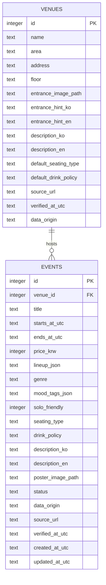

# AMP — SQLite 데이터베이스 명세 (DATABASE.md)

> 버전 1.0 · MVP 2테이블 기본안 · 데이터 저장: 로컬 SQLite · 시각 저장: UTC ISO 8601

## 1. 핵심 원칙

1. **공연(Event)** 과 **공연장(Venue)** 을 별도 엔티티로 관리한다(`venues 1 : N events`).
2. 입구·주소·층수는 장소에 속하고, 출연진·시간·가격은 공연에 속한다.
3. 좌석/드링크 정책은 공연마다 달라질 수 있으므로 `events`의 값이 있으면 우선한다.
4. 원화 가격 `0`은 무료, `NULL`은 가격 미확인. 미확인 가격을 0으로 저장하면 안 된다.
5. 사진 또는 로컬 가이드의 근거가 없다면 `NULL`과 `확인 필요`를 사용한다.
6. 데이터 출처 `verified`와 `demo`를 분리한다. 실재하지 않는 장소/이벤트를 사실처럼 안내하지 않는다.
7. UTC 표준 ISO 문자열(`YYYY-MM-DDTHH:MM:SSZ`)로 일관되게 저장하고 KST로 출력한다.

## 2. ERD



## 3. `venues` 필드

| 필드 | 타입 | 제약 | 설명 |
|---|---|---|---|
| `id` | INTEGER | PK | 자동 증가 ID |
| `name` | TEXT | NOT NULL | 공연장명 |
| `area` | TEXT | CHECK | `sinchon`, `hongdae` |
| `address` | TEXT | NULL 허용 | 실제 주소, 미확인 시 NULL |
| `floor` | TEXT | NULL 허용 | `B1`, `2F` 등 |
| `entrance_image_path` | TEXT | NULL 허용 | 이미지 상대경로 또는 HTTPS URL |
| `entrance_hint_ko/en` | TEXT | NULL 허용 | 입장 방법 설명 |
| `description_ko/en` | TEXT | NULL 허용 | 동네·공연장 소개 2~3줄 |
| `default_seating_type` | TEXT | NULL 허용 | `standing`, `seated`, `mixed` |
| `default_drink_policy` | TEXT | NULL 허용 | 확인된 기본 정책 |
| `source_url` | TEXT | NULL 허용 | 출처 링크 |
| `verified_at_utc` | TEXT | NULL 허용 | 최종 검증 일시 |
| `data_origin` | TEXT | NOT NULL | `verified` 또는 `demo` |

## 4. `events` 필드

| 필드 | 타입 | 제약 | 설명 |
|---|---|---|---|
| `id` | INTEGER | PK | 자동 증가 ID |
| `venue_id` | INTEGER | NOT NULL FK | 공연장 연결 |
| `title` | TEXT | NOT NULL | 공연명, 길이 1..120자(애플리케이션 검증) |
| `starts_at_utc` | TEXT | NOT NULL | UTC 시작 시각 |
| `ends_at_utc` | TEXT | NULL 허용 | UTC 종료 시각 |
| `price_krw` | INTEGER | >=0 또는 NULL | 원화 가격 |
| `lineup_json` | TEXT | NOT NULL | JSON 문자열 배열(빈 배열 가능) |
| `genre` | TEXT | NULL 허용 | 사전 정의 장르 예: indie, jazz |
| `mood_tags_json` | TEXT | NOT NULL | JSON 문자열 배열(빈 배열 가능) |
| `solo_friendly` | INTEGER | NULL/0/1 | 검수된 혼자 방문 적합성 |
| `seating_type` | TEXT | NULL 허용 | 공연별 관람 방식 오버라이드 |
| `drink_policy` | TEXT | NULL 허용 | 공연별 드링크 규정 오버라이드 |
| `description_ko/en` | TEXT | NULL 허용 | 행사 소개 |
| `poster_image_path` | TEXT | NULL 허용 | 이미지 상대경로 |
| `status` | TEXT | NOT NULL | `draft`, `published`, `cancelled` |
| `data_origin` | TEXT | NOT NULL | `verified` 또는 `demo` |
| `source_url` | TEXT | NULL 허용 | 공연 출처 링크 |
| `verified_at_utc` | TEXT | NULL 허용 | 최종 검증 일시 |
| `created_at_utc` | TEXT | NOT NULL | DB 등록 시각 |
| `updated_at_utc` | TEXT | NOT NULL | DB 변경 시각 |

**메모:** `solo_friendly`는 포스터만으로 추정하기 어려우므로 초기 시드 데이터에서 조사·검증한 값만 사용한다. 사용자 판단이 근거 없는 경우 NULL.

## 5. 최소 SQLite DDL

```sql
PRAGMA foreign_keys = ON;

CREATE TABLE IF NOT EXISTS venues (
    id INTEGER PRIMARY KEY AUTOINCREMENT,
    name TEXT NOT NULL,
    area TEXT NOT NULL CHECK (area IN ('sinchon', 'hongdae')),
    address TEXT,
    floor TEXT,
    entrance_image_path TEXT,
    entrance_hint_ko TEXT,
    entrance_hint_en TEXT,
    description_ko TEXT,
    description_en TEXT,
    default_seating_type TEXT CHECK (
        default_seating_type IS NULL OR
        default_seating_type IN ('standing', 'seated', 'mixed')
    ),
    default_drink_policy TEXT,
    source_url TEXT,
    verified_at_utc TEXT,
    data_origin TEXT NOT NULL CHECK (data_origin IN ('verified', 'demo'))
);

CREATE TABLE IF NOT EXISTS events (
    id INTEGER PRIMARY KEY AUTOINCREMENT,
    venue_id INTEGER NOT NULL REFERENCES venues(id),
    title TEXT NOT NULL,
    starts_at_utc TEXT NOT NULL,
    ends_at_utc TEXT,
    price_krw INTEGER CHECK (price_krw IS NULL OR price_krw >= 0),
    lineup_json TEXT NOT NULL DEFAULT '[]' CHECK (json_valid(lineup_json)),
    genre TEXT,
    mood_tags_json TEXT NOT NULL DEFAULT '[]' CHECK (json_valid(mood_tags_json)),
    solo_friendly INTEGER CHECK (solo_friendly IS NULL OR solo_friendly IN (0, 1)),
    seating_type TEXT CHECK (
        seating_type IS NULL OR seating_type IN ('standing', 'seated', 'mixed')
    ),
    drink_policy TEXT,
    description_ko TEXT,
    description_en TEXT,
    poster_image_path TEXT,
    status TEXT NOT NULL DEFAULT 'published'
        CHECK (status IN ('draft', 'published', 'cancelled')),
    data_origin TEXT NOT NULL CHECK (data_origin IN ('verified', 'demo')),
    source_url TEXT,
    verified_at_utc TEXT,
    created_at_utc TEXT NOT NULL,
    updated_at_utc TEXT NOT NULL
);

CREATE INDEX IF NOT EXISTS idx_events_status_start
    ON events(status, starts_at_utc);
CREATE INDEX IF NOT EXISTS idx_events_venue
    ON events(venue_id);
CREATE INDEX IF NOT EXISTS idx_events_price
    ON events(price_krw);
CREATE INDEX IF NOT EXISTS idx_venues_area
    ON venues(area);
```

**구현 주의:** SQLite `json_valid()`는 JSON1 기능 사용 가능 여부에 영향을 받는다. 프로젝트 실행 환경의 SQLite를 확인하고, DB 수준 제약뿐 아니라 Pydantic에서도 리스트 원소의 타입을 검증한다. 앱 연결마다 `PRAGMA foreign_keys=ON` 설정 필요.

## 6. 값 변환 및 정책

### 시간
- 포스터 추출 `starts_at_local`: `2026-11-07T19:00:00` **서울 현지 시각**.
- 저장: `2026-11-07T10:00:00Z`.
- 읽기: `starts_at`은 UTC 문자열을 반환, UI에서 `2026.11.07 19:00`으로 표시.
- `today` 검색: 서버 서울 시간 자정 00:00:00부터 다음날 자정 전까지.
- 일자 필터와 `upcoming=true`가 함께 있으면, 해당 날짜의 **현재 이후 공연만**.

### 추천 하드 필터
```sql
SELECT e.*
FROM events e
JOIN venues v ON e.venue_id = v.id
WHERE e.status = 'published'
  AND e.starts_at_utc >= :now_utc
  AND (:min_utc IS NULL OR e.starts_at_utc >= :min_utc)
  AND (:max_utc IS NULL OR e.starts_at_utc < :max_utc)
  AND (:area IS NULL OR v.area = :area)
  AND (:max_price IS NULL OR (
        e.price_krw IS NOT NULL AND e.price_krw <= :max_price
      ));
```

`date`가 있으면 서울 날짜의 UTC 시작과 다음 날 UTC 시작을 `:min_utc`, `:max_utc`로 계산한다. UTC 문자열은 포맷을 통일했으므로 문자열 비교가 가능하다.

### 점수 정렬(MVP 권장)
- 요구한 `mood_tags` 한 개 일치: +40점(중복 태그는 1회만 계산)
- `solo_friendly=true` 요청과 데이터가 true: +20점
- 조건 일치 후보를 점수 내림차순, 시작 시간 오름차순, ID 오름차순으로 정렬
- `genre`가 추천 의도에 추가된다면 P1에서 명확한 규칙을 정의할 것

**가격·날짜·지역은 점수화하지 않고 먼저 제외 조건으로 적용.** 잘못된 일자/가격의 공연이 높은 점수로 추천되는 상황 방지.

## 7. 초기 시드 데이터 규칙

- 최소 `venues >= 4`, `events >= 20`.
- 검색 데모 키워드(`신촌`, `오늘`, `2만원 이하`, `잔잔한`, `혼자`)를 만족하는 **향후 공연** 최소 3개 준비.
- 테스트의 `오늘`은 시스템 날짜에 의존하므로, 데모 데이터 생성 시 실행일 기준 상대 날짜로 생성하거나 테스트 시계를 고정한다.
- 포스터 추출 시연용 등록 데이터는 기존 시드와 다른 신규 이벤트로 준비.
- 사진·포스터의 사용 허가 확인. 허가가 불명확하면 직접 만든 데모 이미지 사용.
- 합성 공연/공연장은 전부 `data_origin=demo` 표시; 실제 공연으로 오인시키지 않기.

## 8. 관리·마이그레이션

- 로컬에서는 `backend/data/amp.db` 사용; 저장소에는 DB 파일 커밋 금지.
- `seed.py`는 재실행 가능하도록 설계(중복 삽입 방지/테스트용 초기화 별도).
- SQLite `venv`와 임시 업로드 폴더는 `.gitignore` 처리.
- 스키마가 바뀌면 단순 테스트 환경은 재시드 가능; 팀 협업 시 DB 변경 파일을 명시적으로 버전 관리.
- 배포 환경에서는 SQLite 파일과 업로드 이미지를 **영구 볼륨**에 두거나 관리형 DB/객체 스토리지로 전환.

**연관:** [프로젝트 명세](./PROJECT.md) · [API 계약](./API.md)
